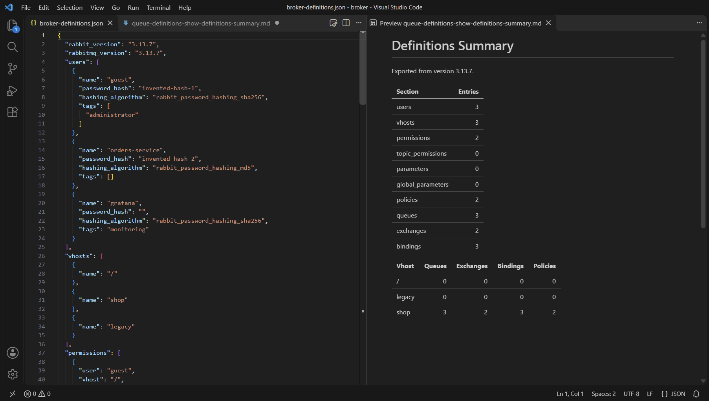
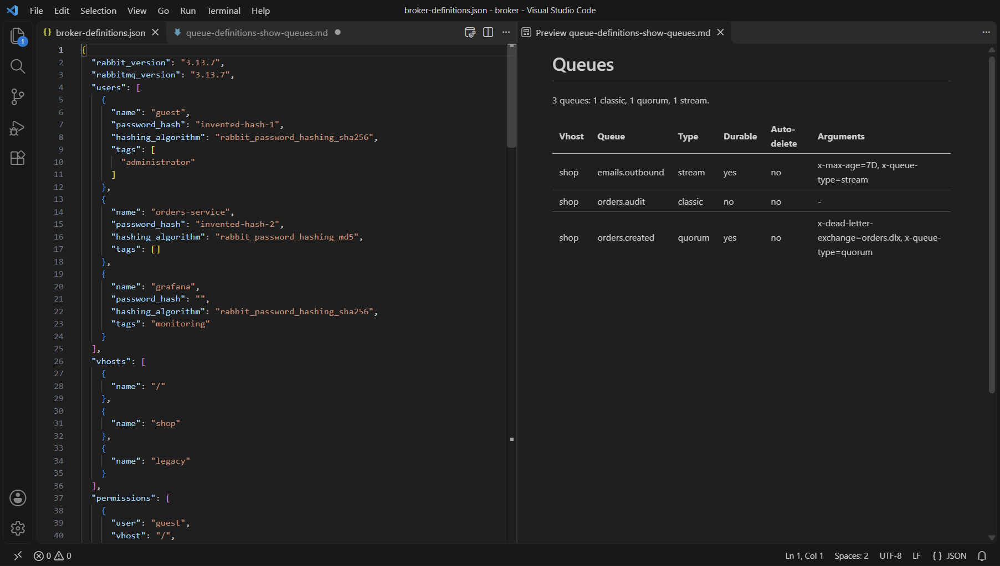
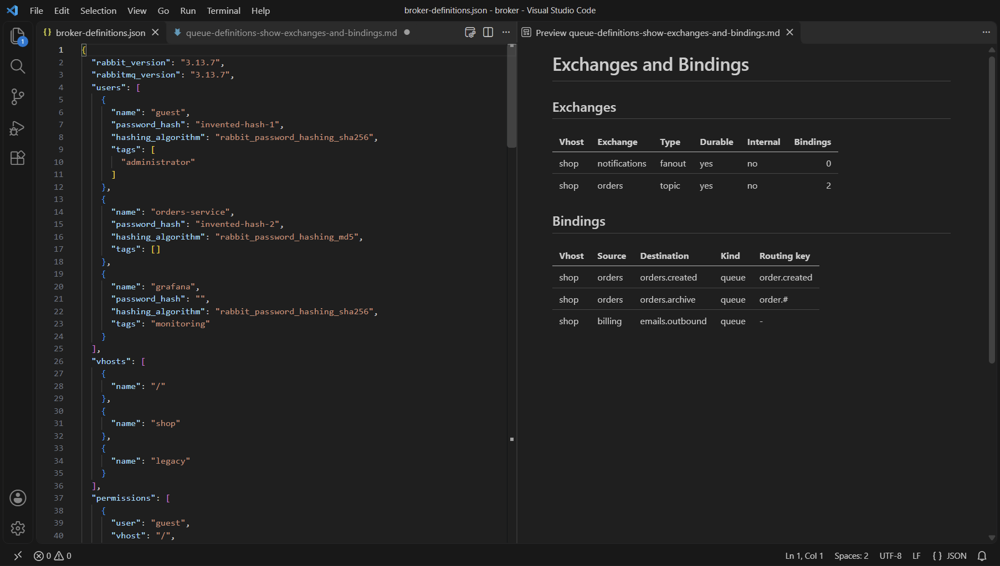
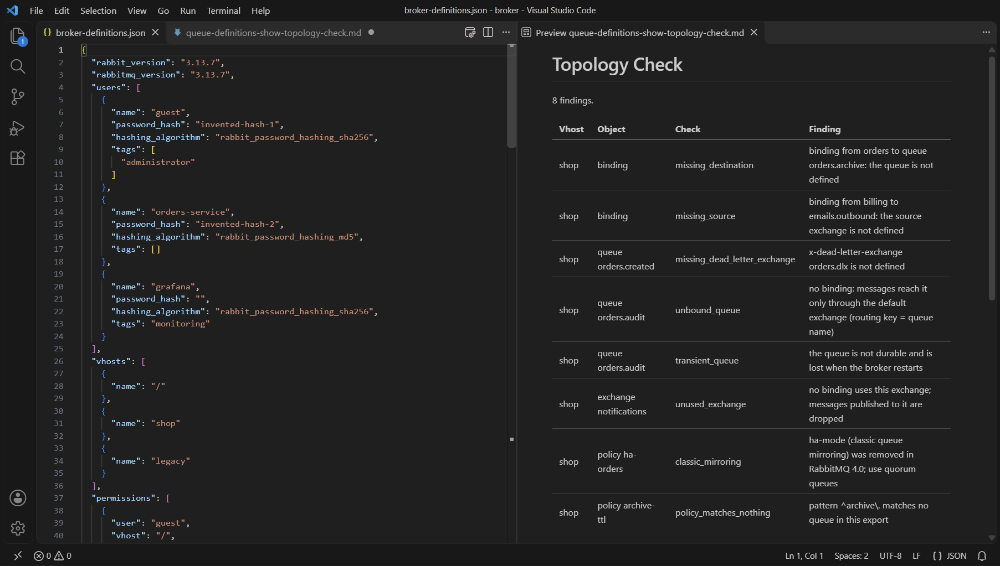
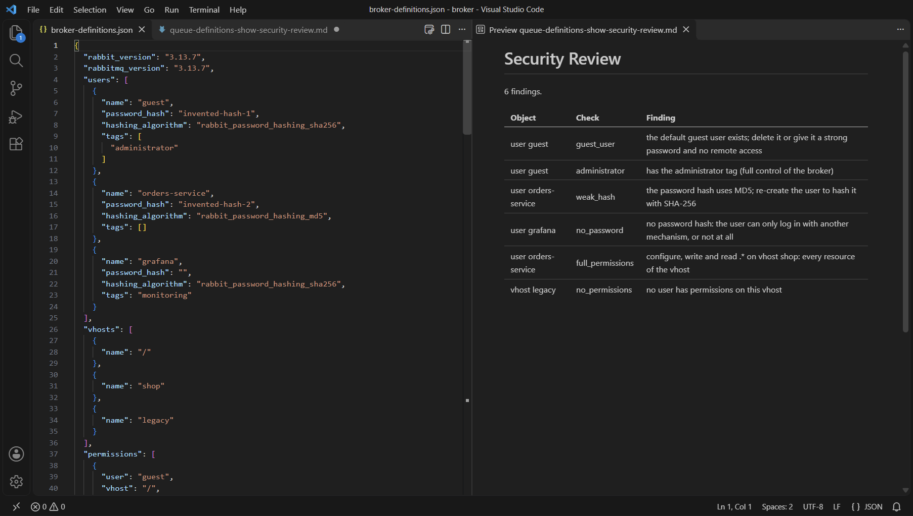

# Queue Definitions Atlas

Queue Definitions Atlas reads RabbitMQ definitions exports and turns them into clear Markdown reports: what the export contains per virtual host, every queue with its type, durability and arguments, every exchange with its bindings, topology problems such as bindings to missing queues, dead-letter exchanges that do not exist and policies that match nothing, and security risks such as the guest user, administrator accounts, weak password hashes and full permissions.

Everything runs on your computer. There is no telemetry. The only network request the extension ever makes is the licence check for the optional Pro tier (see [Privacy](PRIVACY.md)).

## What it does

* **Show Definitions Summary**: The export at a glance: version, entries per section, and queues, exchanges, bindings and policies per virtual host.
* **Show Queues**: Every queue with its type (classic, quorum, stream), durability, auto-delete and arguments.
* **Show Exchanges And Bindings**: Every exchange with its type and number of bindings, and every binding with its routing key.
* **Show Topology Check** (Pro): Bindings to missing queues or exchanges, missing dead-letter exchanges, unbound queues, unused exchanges and policy problems.
* **Show Security Review** (Pro): The guest user, administrator accounts, users without passwords, MD5 hashes, full permissions and unused virtual hosts.

## Free, trial and Pro

| Feature | Free | Pro |
| --- | :---: | :---: |
| Show Definitions Summary | yes | yes |
| Show Queues | yes | yes |
| Show Exchanges And Bindings | yes | yes |
| Show Topology Check |  | yes |
| Show Security Review |  | yes |
| Open Sample File, walkthrough, Report A Problem | yes | yes |

The free reports need no key, no account and no network connection, and they will not be moved behind the licence key later. The first Pro command starts a **free 14-day trial** on this computer. After that, Pro is a one-time purchase, not a subscription: **Pro Personal USD 19** (one person, use at work allowed) or **Pro Business USD 39 per user** (one key per user of an organisation). A key works on up to 3 computers. The checkout page shows the final price and any taxes for your country. Licence keys are sold by Dodo Payments, the merchant of record. Details: [licence](docs/licence.md), [terms](TERMS.md).

## Commands

Open the Command Palette and type `Queue Definitions Atlas`.

| Command | Tier |
| --- | :---: |
| Queue Definitions Atlas: Show Definitions Summary | Free |
| Queue Definitions Atlas: Show Queues | Free |
| Queue Definitions Atlas: Show Exchanges And Bindings | Free |
| Queue Definitions Atlas: Show Topology Check | Pro |
| Queue Definitions Atlas: Show Security Review | Pro |
| Queue Definitions Atlas: Open Sample File | Free |
| Queue Definitions Atlas: Open Walkthrough | Free |
| Queue Definitions Atlas: Show Documentation | Free |
| Queue Definitions Atlas: Report A Problem | Free |
| Queue Definitions Atlas: Buy Pro | Free |
| Queue Definitions Atlas: Enter Licence Key | Free |
| Queue Definitions Atlas: Show Licence Status | Free |
| Queue Definitions Atlas: Remove Licence From This Machine | Free |

## Settings

| Setting | Default | Meaning |
| --- | --- | --- |
| `queueDefinitionsAtlas.maxFileSizeMB` | 50 | Largest file a report reads (0.1 to 50 MB; VS Code passes files only up to 50 MB to extensions). |
| `queueDefinitionsAtlas.openReportsAsPreview` | true | Open each report in the Markdown preview as well. |

## FAQ

**Does Queue Definitions Atlas connect to my broker?**
No. It reads the export file only; nothing is sent anywhere and no credentials are needed. Password hashes in the export are never shown.

**Why is classic mirroring reported?**
Classic queue mirroring (ha-mode policies) was removed in RabbitMQ 4.0. The topology check lists every policy that still uses it, so you can move those queues to quorum queues before upgrading.

**Why is an unbound queue a finding?**
A queue without a binding only receives messages published to the default exchange with its exact name. That is fine for work queues, but it often means a binding was forgotten.

**Are policy patterns checked exactly as the broker does?**
Patterns are evaluated as regular expressions against the names in the export; a few rare constructs differ between regex engines, and patterns with nested quantifiers are skipped so that a hostile file cannot slow the editor.

## For IT and procurement

* Publisher: SmallStepsStudio (Visual Studio Marketplace), smallstepsstudio (Open VSX).
* Network: one host, `live.dodopayments.com`, for the licence check only, and only after a key is entered. No telemetry. The trial uses no network.
* Files are read from the editor only; the extension writes no files and changes none.
* Source: <https://github.com/small-steps-studio/queue-definitions-atlas>.
* Licence agreement: [LICENSE.txt](LICENSE.txt). Terms: [TERMS.md](TERMS.md). Privacy: [PRIVACY.md](PRIVACY.md).

## Support

Run **Queue Definitions Atlas: Report A Problem** or open an issue at <https://github.com/small-steps-studio/queue-definitions-atlas/issues>. Never post a licence key or confidential data in a public issue.

RabbitMQ is a trademark of Broadcom Inc. and/or its subsidiaries; Queue Definitions Atlas is an independent product and is not affiliated with or endorsed by Broadcom.
